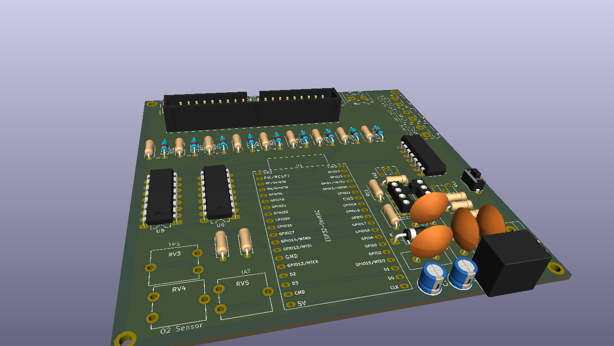

# Engine Simulator 2.0

Simulatore di motore per il test di ECU (**Speeduino V0.4**) basato su **ESP32-32U devKitC**.
Il sistema si collega alla centralina tramite il connettore IDC 40-pin standard di Speeduino e genera i segnali necessari per simulare il funzionamento di un motore reale.



## Architettura

### Segnali generati dall'ESP32

| Segnale | Pin ESP32 | Verso Speeduino | Metodo |
|:--------|:---------:|:---------------:|:-------|
| Crank Trigger | GPIO 12 | IDC Pin 25 | Onda quadra via timer HW, level shifter 3.3V->5V |
| Cam 1 Trigger | GPIO 13 | IDC Pin 24 | Onda quadra via timer HW, level shifter 3.3V->5V |
| Cam 2 Trigger | GPIO 14 | IDC Pin 24 (opz.) | Onda quadra via timer HW, level shifter 3.3V->5V |
| CLT (Temperatura) | GPIO 26 (DAC2) | IDC Pin 19 | Tensione analogica 0-3.3V, amplificata a 0-5V |
| MAP (Pressione) | GPIO 25 (DAC1) | IDC Pin 11 | Tensione analogica 0-3.3V, amplificata a 0-5V |

### Segnali gestiti manualmente (potenziometri)

| Segnale | Pin Speeduino | Note |
|:--------|:-------------:|:-----|
| TPS (Acceleratore) | IDC Pin 22 | Potenziometro a 5V, parte comune verso ESP32 ADC (GPIO 34) via partitore |
| IAT (Temperatura Aria) | IDC Pin 20 | Potenziometro collegato direttamente a Speeduino |
| O2 (Sonda Lambda) | IDC Pin 21 | Potenziometro collegato direttamente a Speeduino |

### Segnali in ingresso dall'ECU

| Segnale | Pin ESP32 | Da Speeduino | Note |
|:--------|:---------:|:------------:|:-----|
| Fan Feedback | GPIO 27 | IDC Pin 15 | Stato ventola (0V = accesa), partitore 5V->3.3V |

### Monitoraggio uscite ECU

Le uscite Speeduino (iniettori, candele, ventola, idle, VVT, boost, pompa carburante) vengono lette dall'ESP32 tramite buffer CD4050BE per il calcolo del timing (FASE 2).

---

## Funzionalita' Firmware

- **64 pattern ruote foniche** (compatibile ArduStim): 60-2, 36-1, 24-1, LS1, 58X, Chrysler NGC, BMW N20, GM 40-tooth OSS, e molti altri
- **Modello di inerzia RPM**: cranking 0->350 RPM, poi idle a 850 RPM + (TPS x 6150), con filtro passa-basso
- **Pulsante Start/Stop**: avvia il motore con rampa di cranking, stabilizzazione a idle, arresto graduale
- **Simulazione MAP dinamica**: 100 kPa a motore spento, 85 kPa in cranking, 30-100 kPa in funzione di RPM/TPS
- **Simulazione CLT dinamica**: riscaldamento graduale, raffreddamento con ventola, legge di Newton a motore spento
- **Interfaccia seriale USB**: protocollo ArduStim per configurazione ruota fonica e modalita' RPM da TunerStudio
- **Monitoraggio timing Speeduino (FASE 2)**: input capture via ISR sui 9 ingressi CD4050BE (4 iniettori + 4 candele + fan) — misura on-time iniettori (ms), frequenza, duty, dwell candele e anticipo in gradi BTDC
- **WiFi AP + Dashboard web (FASE 3)**: SSID `EngineSimulator2.0` / pass `1234567890` / IP `192.168.254.1`, dashboard fluida su `/`, selezione ruota fonica tra i 64 pattern e salvataggio su NVS su `/setup`, endpoint `/api/data` JSON
- **Modalita' di sincronizzazione all'avvio (Sync Mode)**: Passive (avvio autonomo) o Active (avvio reale pilotato dalla ECU), selezionabile dalla pagina `/setup` e salvata su NVS

### Sincronizzazione all'avvio (Sync Mode)

All'avvio del motore (pulsante Start/Stop fisico o `/api/start`), il simulatore si comporta secondo
la **Sync Mode** selezionata nella pagina `/setup` e memorizzata su NVS (key `syncMode`):

| Modalita' | Comportamento |
|:----------|:--------------|
| **Passive** (default) | Completamente autonoma. Il cranking porta gli RPM da 0 a 350, poi il motore passa a RUNNING da solo. |
| **Active** | Avvio reale pilotato dalla ECU. Il motore resta in CRANKING (RPM limitati a 350) finche' la Speeduino non inietta/accende davvero: passa a RUNNING solo quando rileva attivita' sia degli **iniettori** sia delle **candele** (finestra 400 ms) e RPM ≥ 250. Se non rileva nessun firing entro **10 secondi**, il cranking si ferma e il motore torna a OFF. |

Il rilevamento del firing riusa le ISR di input capture della FASE 2: le ISR di iniettori/candele
aggiornano i marcatori `lastInjEventUs` / `lastIgnEventUs`, esposti tramite gli helper
`hasRecentInjection/Ignition/Firing(windowMs)` in `timing.cpp`. Il valore attivo e' riportato anche
nel JSON di `/api/data` come `"syncMode":0|1`.

### Stato di verifica

| Modulo | Stato |
|:-------|:------|
| FASE 1 — Generazione Crank/Cam e modello motore | **Verificata su hardware** (Speeduino/Mega2560 legge i giri; fix registri `GPIO.out_w1ts/w1tc` in ISR per core v3.3.x) |
| FASE 2 — Timing iniettori/candele (input capture) | **Implementata e compilata**; pilota la logica di avvio Sync Mode Active |
| FASE 3 — WiFi AP + dashboard web | **Verificata su hardware** (dashboard, `/setup` e Sync Mode Passive/Active testate) |

Dettagli e riferimenti: `doc/WORKING_VERSION_IT.md`.

---

## Struttura delle Directory

```
Engine Simulator 2.0/
├── Engine_Simulator_2_0/         # Firmware ESP32 (unica origine; cartella = nome sketch)
│   ├── Engine_Simulator_2_0.ino  # Sketch principale (timer, simulazione, state machine)
│   ├── comms.cpp / comms.h       # Parser comandi seriale (protocollo ArduStim)
│   ├── globals.h                 # Strutture dati condivise (incluso enum SyncMode)
│   ├── timing.cpp / timing.h     # Input capture iniettori/candele (FASE 2)
│   ├── web.cpp / web.h           # WiFi AP + dashboard + /setup + /api/data (FASE 3)
│   └── wheel_defs.h              # 64 pattern ruote foniche
├── Hardware/                     # Design PCB (KiCad 10.0)
│   └── Engine Simulator 2.0/
│       ├── *.kicad_sch           # Schema elettrico
│       ├── *.kicad_pcb           # Layout PCB
│       ├── *.kicad_pro           # Progetto KiCad
│       ├── BOM.md                # Bill of Materials (aggiornata dal netlist)
│       └── Gerbers/              # File di fabbricazione (Gerber + drill)
├── doc/                          # Documentazione (inglese + italiano)
│   ├── ESP32U_PIN_ASSIGNMENT_EN.md / _IT.md
│   ├── SPEEDUINO_V04_IDC40_PINOUT_EN.md / _IT.md
│   ├── dupont_pinout_EN.md / _IT.md
│   └── WORKING_VERSION_EN.md / _IT.md
├── images/                       # Asset del README
├── README.md                     # README (inglese)
├── README_IT.md                  # Questo file (italiano)
└── LICENSE                       # MIT
```

---

## Requisiti Hardware

### Componenti Principali

| Componente | Quantita' | Descrizione |
|:-----------|:---------:|:------------|
| ESP32-WROOM-32U | 1 | Microcontroller principale |
| 74AHCT125 | 1 | Quad level shifter 3.3V -> 5V (Crank, Cam1, Cam2) |
| TLV2372 | 1 | Doppio op-amp rail-to-rail (buffer MAP, CLT) |
| R-78E5.0-1.0 (RECOM) | 1 | Regolatore switching drop-in 12V -> 5V, 1A, 91% |
| Connettore IDC 40-pin | 1 | Connessione a Speeduino V0.4 |
| CD4050BE | 2 | Hex buffer per ingressi ECU (iniettori/candele/ventola) |
| Potenziometri trimmer | 5 | (2kOhm x2, 10kOhm x3) — TPS, IAT, O2, trimmer |
| Pulsante | 1 | Start/Stop |
| Jack DC | 1 | Alimentazione 12V |

### Livelli di Tensione

| Segmento | Tensione | Metodo |
|:---------|:--------:|:-------|
| Alimentazione board | 12V | Jack DC esterno |
| Alimentazione logica | 5V | R-78E5.0-1.0 (switching, drop-in) da 12V |
| ESP32 e sensori | 3.3V | Regolatore onboard ESP32 |
| Uscite digitali ESP32 -> ECU | 3.3V -> 5V | 74AHCT125 |
| Uscite analogiche ESP32 -> ECU | 0-3.3V -> 0-5V | TLV2372 (guadagno 1.5x) |
| Ingresso Fan da ECU | 5V -> 3.3V | Partitore resistivo |

---

## Build e Upload

### Prerequisiti

- [Arduino IDE](https://www.arduino.cc/en/software) o [Arduino CLI](https://arduino.github.io/arduino-cli/)
- Pacchetto board **esp32** installato (`esp32:esp32` via Board Manager)
- Scheda selezionata: `ESP32 Dev Module` o `ESP32-WROOM-32U`
- Librerie per la dashboard (FASE 3) — usare i fork **ESP32Async** (compatibili col
  core esp32 v3.3.x e mbedTLS 3; le versioni classiche `me-no-dev` non compilano):
  - **ESP Async WebServer** (`arduino-cli lib install "ESP Async WebServer"`)
  - **Async TCP** (`arduino-cli lib install "Async TCP"`)

### Compilazione e caricamento

```bash
# Via Arduino CLI (prima volta: installa anche le librerie della dashboard)
arduino-cli lib install "ESP Async WebServer" "Async TCP"
arduino-cli compile --fqbn esp32:esp32:esp32 "Engine_Simulator_2_0"
arduino-cli upload --fqbn esp32:esp32:esp32 --port COMx "Engine_Simulator_2_0"
```

### Configurazione

La ruota fonica e la Sync Mode possono essere selezionate tramite:
1. **Dashboard web** (consigliata): connettiti alla rete WiFi `EngineSimulator2.0` (password `1234567890`)
   e apri `http://192.168.254.1` -> pagina `/setup` per scegliere la ruota e la **Sync Mode** (salvataggio persistente su NVS)
2. **Seriale USB** (115200 baud): comando `X` per ruota successiva, `S<n>` per selezionare per indice
3. **ArduStim GUI**: software desktop che si collega alla seriale per configurare pattern e modalita'

---

## Note di Progetto

- Il **MAP sensor** integrato sulla Speeduino V0.4 (IDC Pin 11) non puo' essere usato come alternativa al DAC generato dall'ESP32 per le prove di simulazione. In questo caso, il pin MAP dell'IDC va collegato al PCB del simulatore.
- La **ventola** e' gestita in retroazione: Speeduino la controlla, l'ESP32 la legge per modellare la temperatura CLT.
- I **potenziometri IAT e O2** sono puramente manuali e non influenzano la simulazione dell'ESP32. Servono per testare le correzioni della ECU.
- Il **PCB KiCad** (`Hardware/Engine Simulator 2.0/`) e' completo: routing a 2 strati con piano GND su B.Cu in thermal relief. DRC: **0 errori di clearance e 0 piazzole sconnesse**; restano solo warning cosmetici (altezza testo serigrafia e librerie footprint locali non abilitate). Il report aggiornato e' in `Engine Simulator 2.0-drc.rpt`.
- Il firmware e' pubblicato da un'unica cartella (`Engine_Simulator_2_0/`); la vecchia cartella `firmware/` (duplicato storico) e' stata rimossa.

### Output di fabbricazione (Gerber + Drill)

I file di fabbricazione sono generati con `kicad-cli` e pronti per qualsiasi fab (JLCPCB/PCBWay/PCBcart):

- **`Hardware/Engine Simulator 2.0/Gerbers/`** — Gerber RS-274X a 9 layer (`F_Cu`, `B_Cu`, `F_Paste`, `B_Paste`, `F_Mask`, `B_Mask`, `F_SilkS`, `B_SilkS`, `Edge_Cuts`) + job file `.gbrjob`.
- **`Hardware/Engine Simulator 2.0/Gerbers/`** — Drill Excellon separati: `-PTH.drl` (fori placcati, 0,3–2,2 mm) e `-NPTH.drl` (0 NPTH).
- **`Hardware/Engine Simulator 2.0/Engine_Simulator_2.0_FAB_gerbers.zip`** — archivio zip di tutti i Gerber+drill pronto per l'upload diretto sul sito del fab.

Scheda: **2 strati, 100×100 mm, spessore 1,6 mm, HASL**, pista min. 0,2 mm, clearance min. 0,21 mm, foro drill min. 0,3 mm (via) / 2,2 mm (fori montaggio M2, PTH collegato a GND).
